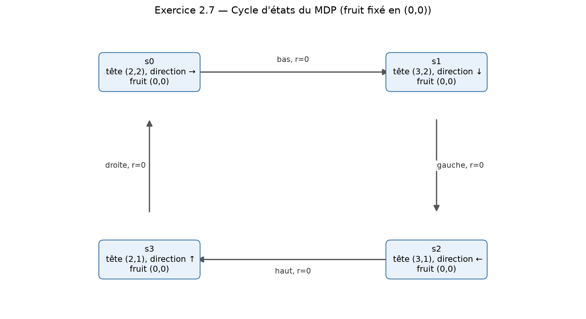
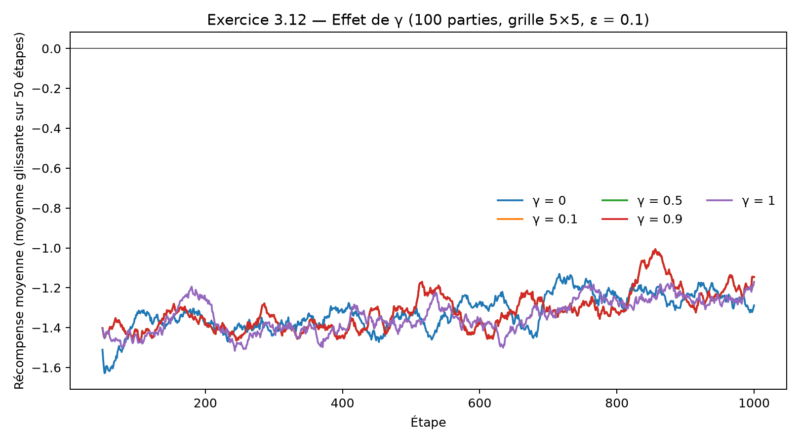

# Partie A — TP MDP : Snake

Les réponses ci-dessous couvrent les questions attribuées à Sidy. Le code complet du jeu se trouve dans `snake.py`, celui du joueur Q-Learning dans `players.py`, et les graphiques demandés sont produits par `partie_a.py`.

## Exercice 1 — Jeu de base

### 1.1 — Classe et grille

La classe `ShortSnake` reçoit la taille de la grille et construit une grille carrée.

```python
class ShortSnake:
    def __init__(self, n, m=None, length=1):
        self.n = n
        self.m = n if m is None else m
        self.length = length
        self.grid = [["." for _ in range(self.m)] for _ in range(self.n)]
```

### 1.2 — Position et direction initiales

Le serpent commence au milieu, orienté vers la droite. `snake_pos` désigne sa tête.

```python
head = (self.n // 2, self.m // 2)
self.snake_dir = RIGHT
self.body = [(head[0], (head[1] - i) % self.m) for i in range(length)]
self.snake_pos = head
```

### 1.3 — Position du fruit

Le fruit est choisi au hasard parmi les cases qui ne sont pas occupées par le serpent.

```python
def _place_fruit(self):
    free = [(i, j) for i in range(self.n) for j in range(self.m)
            if (i, j) not in self.body]
    self.fruit_pos = random.choice(free)
```

### 1.4 — Score initial

Le score commence à zéro.

```python
self.score = 0
```

### 1.5 — Déplacement et demi-tour interdit

`None` conserve la direction courante. Une direction opposée est ignorée ; les autres changent la direction avant le déplacement.

```python
def actions(self):
    return [d for d in DIRECTIONS if d != opposite(self.snake_dir)]

def move(self, direction=None):
    if direction is not None and direction != opposite(self.snake_dir):
        self.snake_dir = direction
    reward = 0
    i = self.snake_pos[0] + self.snake_dir[0]
    j = self.snake_pos[1] + self.snake_dir[1]
    if not (0 <= i < self.n and 0 <= j < self.m):
        reward -= 10
        i, j = i % self.n, j % self.m
    self.snake_pos = (i, j)
    self.body = [self.snake_pos] + self.body[:-1]
    if self.length >= 5 and self.snake_pos in self.body[1:]:
        reward -= 10
    if self.snake_pos == self.fruit_pos:
        reward += 10
        self._place_fruit()
    self.score += reward
    return reward
```

### 1.6 — Traversée d'un bord et pénalité

Lorsqu'une tête sort de la grille, elle réapparaît sur le bord opposé et la récompense diminue de 10.

```python
if not (0 <= i < self.n and 0 <= j < self.m):
    reward -= 10
    i, j = i % self.n, j % self.m
```

### 1.7 — Récompense et nouveau fruit

Manger le fruit rapporte 10 points, puis un nouveau fruit est placé.

```python
if self.snake_pos == self.fruit_pos:
    reward += 10
    self._place_fruit()
self.score += reward
return reward
```

### 1.8 — Affichage

`__str__` construit une représentation textuelle de la grille, marque le corps, le fruit et la tête, puis ajoute le score.

```python
def __str__(self):
    rows = [row[:] for row in self.grid]
    for i, j in self.body[1:]:
        rows[i][j] = "o"
    fi, fj = self.fruit_pos
    rows[fi][fj] = "*"
    hi, hj = self.snake_pos
    rows[hi][hj] = "@"
    lines = [" ".join(row) for row in rows]
    lines.append(f"score : {self.score}")
    return "\n".join(lines)
```

## Exercice 2 — Modélisation du MDP

### 2.1 — État

Pour le serpent de taille 1, un état contient la position de la tête, sa direction et la position du fruit. Le score n'est pas nécessaire : il ne change pas les transitions ni les récompenses futures.

```python
state = (self.snake_pos, self.snake_dir, self.fruit_pos)
```

### 2.2 — Nombre d'états sur une grille 10 × 10

Il y a 100 positions de tête, 4 directions et 99 positions de fruit (le fruit ne peut pas être sur la tête). Donc :

```text
100 × 4 × 99 = 39 600 états.
```

### 2.3 — Nombre d'états sur une grille N × M

En notant `N × M` le nombre de cases, il y a `N × M` positions de tête, 4 directions et `N × M − 1` positions possibles pour le fruit :

```text
4 × N × M × (N × M − 1) états.
```

### 2.7 — Schéma du MDP

Les actions sont les trois directions qui ne font pas faire demi-tour ; les transitions gardent le fruit en place tant qu'il n'est pas mangé. La figure montre un cycle de quatre états sans fruit mangé ni bord franchi : chaque transition donne donc une récompense nulle. Le schéma est généré par `plot_mdp_schema()` dans `partie_a.py`.



## Exercice 3 — Comparaison des facteurs γ

### 3.12 — Graphique et interprétation

La figure compare les récompenses moyennes de 100 parties indépendantes de 1 000 étapes, sur une grille 5 × 5 avec `ε = 0,1`. La courbe est lissée sur 50 étapes. Le script réinitialise la graine avant chaque valeur de γ afin de contrôler l'aléatoire initial de la comparaison.



| γ | 0 | 0,1 | 0,5 | 0,9 | 1 |
|---|---:|---:|---:|---:|---:|
| Moyenne des 100 premières étapes | -1,424 | -1,406 | -1,406 | -1,406 | -1,423 |
| Moyenne des 100 dernières étapes | -1,270 | -1,195 | -1,195 | -1,195 | -1,221 |

La récompense moyenne s'améliore légèrement pour toutes les valeurs, mais reste négative après 1 000 étapes. Dans cet essai, `γ = 0,1`, `0,5` et `0,9` sont à égalité pour la meilleure moyenne finale ; ces résultats ne permettent pas de les départager. Un γ faible valorise surtout la récompense immédiate, tandis qu'un γ plus élevé prend davantage en compte les récompenses futures. Cette conclusion est limitée à la grille, au nombre de parties et aux paramètres testés.

## Exercice 4 — Serpent de taille 2

### 4.1 — Informations de l'état

L'état doit mémoriser les deux cases occupées dans l'ordre (tête puis queue), la direction du serpent et la position du fruit. La position de la tête seule ne suffit plus à décrire le serpent.

```python
state = (tuple(self.body), self.snake_dir, self.fruit_pos)
```

### 4.2 — Nombre d'états sur une grille N × M

Pour une grille non dégénérée, la tête a `N × M` positions et sa direction (qui fixe la case adjacente de la queue) a 4 possibilités. Le fruit peut occuper l'une des `N × M − 2` autres cases :

```text
4 × N × M × (N × M − 2) états.
```

Par exemple, sur une grille 10 × 10 : `4 × 100 × 98 = 39 200 états`.

### 4.3 — Implémentation

`ShortSnake` prend un paramètre `length`. Avec `length=2`, le corps initial contient la tête et la case immédiatement derrière elle.

```python
game = ShortSnake(10, length=2)
print(game.body)  # [(5, 5), (5, 4)]
```

À chaque déplacement, la nouvelle tête est ajoutée et l'ancienne dernière case est retirée, ce qui conserve une longueur constante :

```python
self.body = [self.snake_pos] + self.body[:-1]
```

### 4.4 — Adaptation de `GreedyPlayer`

Aucun changement spécifique n'est nécessaire : `save_state()` inclut déjà tout le corps, et `GreedyPlayer` indexe les valeurs Q par `(état, action)`. Le corps de taille 2 distingue donc correctement les états.

```python
def save_state(self):
    return (tuple(self.body), self.snake_dir, self.fruit_pos)

def q(self, state, action):
    return self.action_values.get((state, action), 0.0)
```
