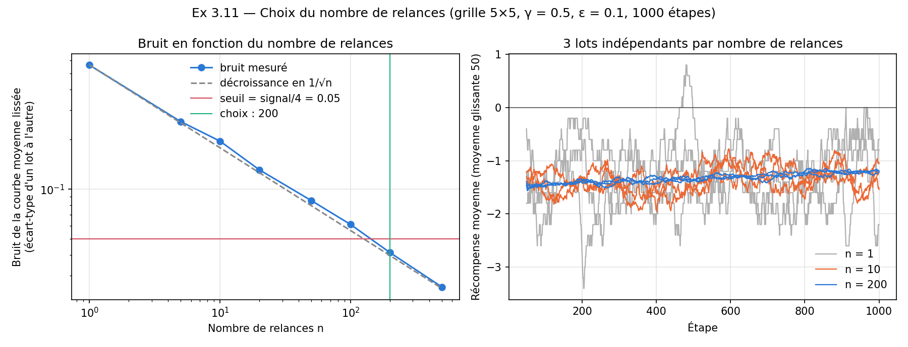
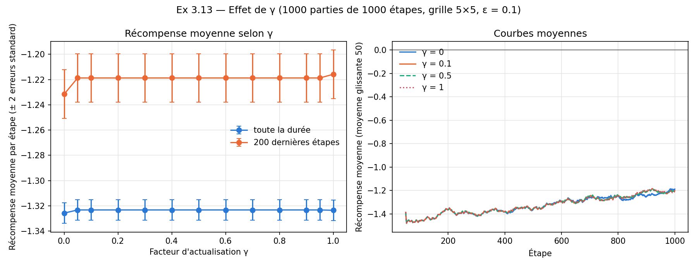
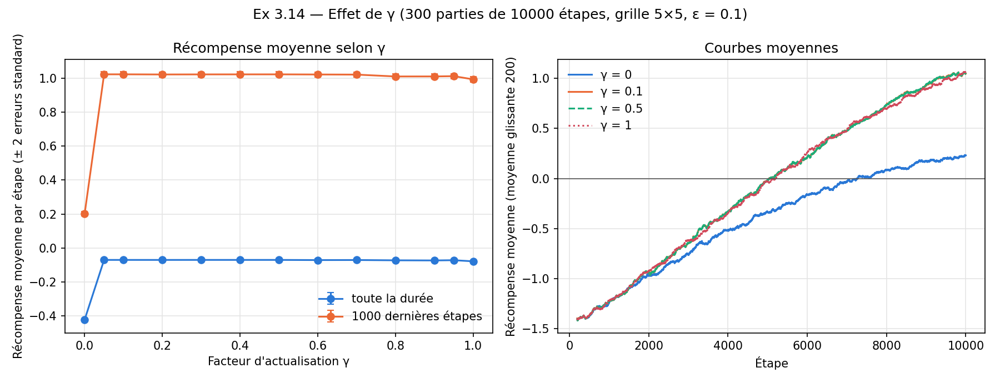
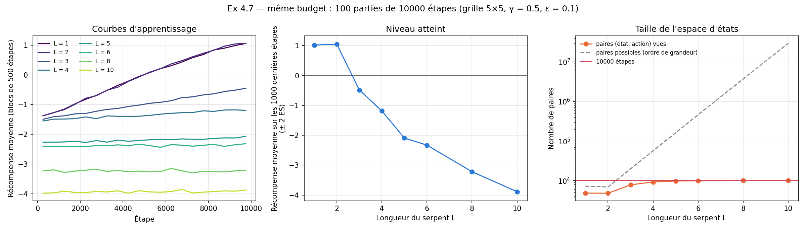
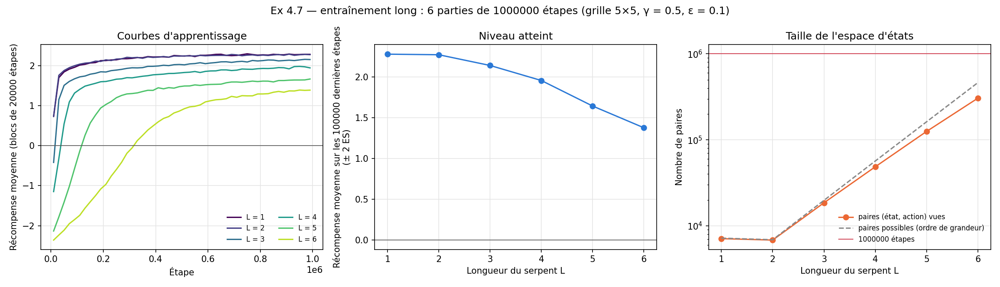

# Partie C — TP MDP : Snake

Les réponses ci-dessous couvrent les questions attribuées à la personne C. Le code des expériences est dans `partie_c.py` ; il s'appuie sur `snake.py`, `players.py` et `simulation.py`.

## Exercice 2 — Modélisation du MDP

### 2.4 — Actions

Les actions sont les quatre directions de déplacement : haut, droite, bas, gauche. Le jeu n'autorise pas le demi-tour, donc dans une situation donnée seules trois d'entre elles sont possibles : on peut continuer tout droit, tourner à gauche ou tourner à droite. L'argument `None` de `move` (« continuer à avancer ») n'est pas une quatrième action : il revient à choisir la direction courante.

```python
def actions(self):
    """Directions autorisées : tout sauf le demi-tour."""
    return [d for d in DIRECTIONS if d != opposite(self.snake_dir)]
```

### 2.5 — Les actions dépendent-elles de l'état ?

Oui, mais seulement par la direction. L'action interdite est l'opposée de `snake_dir`, et `snake_dir` fait partie de l'état (2.1) : un état où le serpent va vers la droite n'autorise pas « gauche », un état où il va vers le haut n'autorise pas « bas », etc. Le nombre d'actions est le même partout (3), mais l'ensemble change avec l'état. Comme `GreedyPlayer` indexe Q par (état, action) et ne choisit que parmi `game.actions()`, une action interdite n'est jamais choisie ni apprise. La position de la tête et celle du fruit n'ont aucun effet sur les actions disponibles : il n'y a ni mur ni mort, le serpent peut toujours avancer.

### 2.6 — Récompenses

La récompense d'une étape est la variation du score. Dans le jeu de base (taille 1), elle vaut :

| Événement | Récompense |
|---|---:|
| La tête franchit un bord (et réapparaît de l'autre côté) | −10 |
| La tête arrive sur le fruit | +10 |
| Les deux à la fois (bord franchi sur la case du fruit) | −10 + 10 = 0 |
| Rien de particulier | 0 |

Les valeurs possibles sont donc −10, 0 et +10 (le test `test_fruit_juste_apres_le_bord` vérifie le cas du bord et du fruit sur le même coup). Pour un serpent de longueur 5 ou plus (exercice 4), une tête qui retombe sur son propre corps ajoute −10 ; le total peut alors descendre jusqu'à −20.

La récompense ne dépend que de l'état et de l'action choisie : le bord franchi et le fruit mangé se déduisent de la position de la tête, de sa direction et de la position du fruit. L'aléa du MDP ne vient donc pas de la récompense mais des transitions : quand le fruit est mangé, le nouveau fruit est tiré au hasard parmi les cases libres, sinon la transition est déterministe. Il n'y a pas d'état terminal : le serpent ne meurt jamais, c'est une tâche continue.

```python
reward = 0
if not (0 <= i < self.n and 0 <= j < self.m):
    reward -= 10                      # bord franchi
...
if self.length >= 5 and self.snake_pos in self.body[1:]:
    reward -= 10                      # auto-intersection
if self.snake_pos == self.fruit_pos:
    reward += 10                      # fruit mangé
```

## Exercice 3 — Q-Learning

### 3.9 — Programme principal

La boucle de jeu est la fonction `play` de `simulation.py` : à chaque étape, le joueur choisit une action, le jeu l'exécute et renvoie la récompense, puis le joueur met à jour son tableau Q avec cette récompense. La fonction renvoie la récompense de chaque étape.

```python
def play(game, player, steps):
    rewards = np.zeros(steps)
    for t in range(steps):
        action = player.get_action()
        value = game.move(action)
        player.reward(action, value)
        rewards[t] = value
    return rewards
```

### 3.11 — Nombre de relances

Une seule partie est très bruitée : chaque étape rapporte −10, 0 ou +10, et le joueur explore au hasard. On relance donc le jeu `n` fois avec un joueur neuf à chaque fois, et on moyenne les récompenses étape par étape (`simulate`).

Pour choisir `n`, on a mesuré le bruit de la courbe moyenne : pour chaque `n`, on tire 10 lots indépendants de `n` parties (graines différentes), on lisse chaque courbe moyenne sur 50 étapes, puis on calcule l'écart-type d'un lot à l'autre, moyenné sur les étapes. Le réglage est celui des questions précédentes : grille 5 × 5, γ = 0,5, ε = 0,1, 1 000 étapes.

| n | 1 | 5 | 10 | 20 | 50 | 100 | 200 | 500 |
|---|---:|---:|---:|---:|---:|---:|---:|---:|
| Bruit | 0,563 | 0,256 | 0,195 | 0,131 | 0,085 | 0,061 | 0,041 | 0,026 |
| Temps par lot (s) | 0,02 | 0,10 | 0,21 | 0,42 | 1,03 | 2,09 | 3,97 | 9,86 |



Le bruit décroît bien comme 1/√n (courbe en pointillés). Le signal à observer est l'amélioration entre les 100 premières et les 100 dernières étapes, soit environ +0,20 (mesurée sur 500 parties). On exige un bruit au moins quatre fois plus petit que ce signal, c'est-à-dire inférieur à 0,05. Le plus petit `n` testé qui le respecte est **n = 200** (bruit 0,041). Avec 100 parties, le bruit (0,061) reste du même ordre que le signal divisé par trois. Passer à 500 réduit encore le bruit mais multiplie le temps de calcul par 2,5.

Cette valeur convient pour voir la tendance d'une courbe. Elle ne suffit pas pour départager deux valeurs de γ dont les résultats diffèrent de moins de 0,05 : ce cas est traité en 3.13.

### 3.13 — Recherche du meilleur facteur d'actualisation

**Protocole.** On teste 13 valeurs de γ (0, 0,05, 0,1, 0,2, …, 0,9, 0,95, 1) sur 1 000 parties de 1 000 étapes (grille 5 × 5, ε = 0,1). C'est plus que les 200 parties de 3.11 : les écarts entre γ sont très inférieurs au seuil de 0,05 de 3.11, il faut donc une précision plus fine. La partie numéro `r` utilise la même graine pour tous les γ, ce qui rend les comparaisons appariées : on calcule, partie par partie, la différence avec le meilleur γ, et on la juge à 2 erreurs standard (ES) de cette différence. Deux critères sont suivis : la récompense moyenne sur toute la durée, et celle des 200 dernières étapes.



| γ | Moyenne sur toute la durée | Moyenne sur les 200 dernières étapes |
|---|---:|---:|
| 0 | −1,326 ± 0,004 | −1,232 ± 0,010 |
| 0,05 à 0,95 | −1,323 ± 0,004 | −1,219 ± 0,010 |
| 1 | −1,323 ± 0,004 | −1,216 ± 0,010 |

**Résultat.** Aucune valeur de γ ne se détache. Toutes les valeurs de 0,05 à 1 donnent exactement les mêmes résultats : avec la même graine, les parties sont identiques d'un bout à l'autre. Sur une partie de contrôle (graine 7), la différence entre γ = 0,1 et γ = 0,9 ne touche que 6 valeurs Q sur 909, et ne change aucune décision. Cela s'explique parce qu'en 1 000 étapes sur une grille 5 × 5, presque aucune paire (état, action) n'est revisitée : le terme `γ · max Q(s', ·)` est presque toujours nul, donc γ n'intervient presque pas. Seul γ = 0 se distingue un peu : −0,016 ± 0,007 sur les 200 dernières étapes (environ 2,3 ES, limite de significativité), et indistinguable sur toute la durée. **À 1 000 étapes, il n'y a donc pas de meilleure valeur discernable** ; si l'on devait en citer une, γ = 1 a la plus haute moyenne sur les 200 dernières étapes, mais l'avance (0,003 ± 0,003) est du bruit.

### 3.14 — Passage à 10 000 étapes

On refait la même recherche avec 300 parties de 10 000 étapes (moins de parties que pour 3.13 car chaque partie coûte dix fois plus). On compare la récompense moyenne sur toute la durée et sur les 1 000 dernières étapes.



| γ | Moyenne sur toute la durée | Moyenne sur les 1 000 dernières étapes |
|---|---:|---:|
| 0 | −0,422 ± 0,002 | +0,202 ± 0,007 |
| 0,05 à 0,7 | −0,070 ± 0,003 | +1,022 à +1,023 ± 0,007 |
| 0,8 à 0,95 | −0,073 ± 0,004 | +1,011 à +1,013 ± 0,008 |
| 1 | −0,079 ± 0,003 | +0,994 ± 0,008 |

**Résultat.** Une structure apparaît, que 1 000 étapes ne laissaient pas voir :

- **γ = 0 est nettement le pire** : −0,82 ± 0,01 par rapport au meilleur sur les 1 000 dernières étapes. Sans prise en compte du futur, la valeur Q d'une action ne reflète que la récompense immédiate ; le serpent ne peut pas apprendre qu'une case mène à un fruit une étape plus tard.
- **Les valeurs de 0,05 à 0,7 forment un plateau** : elles sont indistinguables entre elles (écarts de l'ordre de 0,001 à 0,002, au niveau du bruit).
- **γ = 1 est un peu moins bon** : −0,030 ± 0,010 sur les 1 000 dernières étapes (environ 3 ES) et −0,008 ± 0,004 sur toute la durée. Les valeurs 0,8 à 0,95 sont légèrement en dessous du plateau (−0,011 à −0,013) sans que ce soit significatif. Une explication plausible, que nous n'avons pas testée, est que sans actualisation les valeurs Q d'une tâche continue se propagent sans atténuation et deviennent plus instables.

**La meilleure valeur a-t-elle changé ?** À 1 000 étapes, aucune valeur ne se détache. À 10 000 étapes, le meilleur γ est un plateau de 0,05 à 0,7, avec γ = 0 et γ = 1 en retrait. La valeur 0,5 utilisée depuis le début du TP appartient à ce plateau. Ces conclusions valent pour la grille 5 × 5, ε = 0,1, ces nombres de parties et cette durée d'entraînement ; sur une grille plus grande ou avec un serpent plus long, les états sont moins souvent revisités et l'effet de γ pourrait se manifester plus tard. Une différence très faible comme celle de γ = 0,6 sur toute la durée (−0,001, jugée significative car les écarts appariés sont presque constants) n'a pas d'importance pratique.

**Reproduction.** `python partie_c.py gamma` relance les deux recherches (environ 5 minutes avec 16 cœurs : un processus par valeur de γ) et régénère les deux figures.

## Exercice 4 — Serpent plus long

### 4.7 — Serpents plus longs et auto-intersection

**Protocole.** On réutilise `ShortSnake(5, length=L)` et `GreedyPlayer` sans modification (γ = 0,5, ε = 0,1, grille 5 × 5). À partir de la longueur 5, une tête qui retombe sur son propre corps rapporte −10 : cette règle est déjà dans `ShortSnake.move`. Le script `partie_c.py` compte aussi la part des étapes avec auto-intersection. Les longueurs utilisent les mêmes graines (partie `r` = graine `r`). Deux expériences :

1. **Même budget que 3.14** : 10 000 étapes, 100 parties, longueurs 1, 2, 3, 4, 5, 6, 8 et 10.
2. **Entraînement long** : 1 000 000 d'étapes, seulement 6 parties (coût élevé), longueurs 1 à 6.

**Nombre d'états.** Pour L ≥ 2, chaque case de plus multiplie à peu près par 3 le nombre de corps possibles (3 directions possibles par segment). Un ordre de grandeur du nombre de paires (état, action) est donc 3 × 4·N·M·3^(L−2)·(N·M − L) ; pour L = 2 c'est la formule de 4.2, pour L = 1 celle de 2.3. Sur 5 × 5 : environ 7 200 paires pour L = 1, 6 900 pour L = 2, 20 000 pour L = 3, 57 000 pour L = 4, 160 000 pour L = 5 et 460 000 pour L = 6 (approximation pour L ≥ 5, car le corps peut se recouvrir).

#### Même budget : 10 000 étapes



| L | Récompense, 1er bloc | Récompense, 1 000 dernières étapes | Étapes en auto-intersection | Paires (état, action) vues | Paires revisitées |
|---|---:|---:|---:|---:|---:|
| 1 | −1,38 | +1,02 ± 0,01 | 0 | 4 822 | 46 % |
| 2 | −1,37 | +1,05 ± 0,01 | 0 | 4 784 | 47 % |
| 3 | −1,49 | −0,48 ± 0,01 | 0 | 7 807 | 21 % |
| 4 | −1,55 | −1,19 ± 0,01 | 0 | 9 217 | 8 % |
| 5 | −2,26 | −2,09 ± 0,02 | 6,9 % | 9 749 | 2,5 % |
| 6 | −2,41 | −2,33 ± 0,02 | 8,4 % | 9 913 | 0,9 % |
| 8 | −3,23 | −3,22 ± 0,02 | 16,6 % | 9 990 | 0,1 % |
| 10 | −3,98 | −3,89 ± 0,03 | 23,5 % | 9 999 | 0 % |

(Le bloc initial est de 500 étapes ; les auto-intersections sont mesurées sur les 1 000 dernières étapes.)

À budget égal, les longueurs 1 et 2 sont équivalentes (leurs espaces d'états ont la même taille). Dès la longueur 3, la récompense progresse beaucoup plus lentement, et à partir de 4 les courbes sont presque plates : en 10 000 étapes, le serpent ne revisite presque jamais un état (0 % pour L = 10, soit 10 000 étapes pour 10 000 paires), donc il n'apprend rien. Le niveau négatif vient en bonne partie de la pénalité d'auto-intersection : pour L = 10, 23,5 % des étapes la déclenchent, soit environ −2,35 points par étape sur les −3,89 observés.

#### Entraînement long : 1 000 000 d'étapes



| L | Récompense, 100 000 dernières étapes | Premier bloc de 20 000 étapes à moyenne positive | Étapes en auto-intersection (fin) | Paires vues | Paires revisitées |
|---|---:|---:|---:|---:|---:|
| 1 | +2,28 ± 0,00 | 20 000 | 0 | 7 101 | 98 % |
| 2 | +2,27 ± 0,00 | 20 000 | 0 | 6 834 | 98 % |
| 3 | +2,14 ± 0,00 | 40 000 | 0 | 18 540 | 89 % |
| 4 | +1,96 ± 0,01 | 60 000 | 0 | 48 584 | 76 % |
| 5 | +1,64 ± 0,00 | 140 000 | 0,6 % | 125 122 | 60 % |
| 6 | +1,38 ± 0,01 | 340 000 | 0,9 % | 304 621 | 45 % |

Avec assez d'étapes, tous les serpents finissent par apprendre : la récompense devient positive même pour L = 6, avec l'auto-intersection presque évitée (moins de 1 % des étapes). Le prix est le temps d'entraînement : le nombre d'étapes avant que la récompense devienne positive est environ multiplié par 2 à 2,5 à chaque case supplémentaire (20 000, 40 000, 60 000, 140 000, 340 000), du même ordre que la croissance du nombre d'états (facteur 3). Le nombre de paires vues suit de près l'ordre de grandeur théorique (panneau de droite).

Le niveau final baisse avec la longueur (+2,28 pour L = 1, +1,38 pour L = 6). Les courbes de L = 5 et 6 montent encore à la fin et 45 à 60 % seulement de leurs paires ont été revisitées : l'apprentissage n'est probablement pas terminé, ce qui expliquerait au moins en partie l'écart (nous n'avons pas poussé plus loin pour le vérifier).

**Limite de praticabilité.** Chaque partie d'un million d'étapes a pris environ 30 s ici (350 s pour 36 parties sur 3 processus), et le tableau Q de L = 6 compte déjà plus de 300 000 paires. Par extrapolation, L = 8 demanderait plusieurs millions d'étapes et L = 10 des dizaines de millions d'étapes pour des tableaux Q de millions de paires. C'est peu praticable avec un tableau Q (la mémoire libre de la machine utilisée était d'environ 1,8 Go) : nous nous sommes arrêtés à L = 6 pour l'entraînement long, et à L = 10 pour le test à budget fixe. Pour aller plus loin, il faudrait une représentation d'état plus compacte ou une approximation de la fonction Q (hors du cadre du TP).

**Reproduction.** `python partie_c.py longueurs` relance les deux expériences (environ 7 minutes) et régénère les deux figures.
